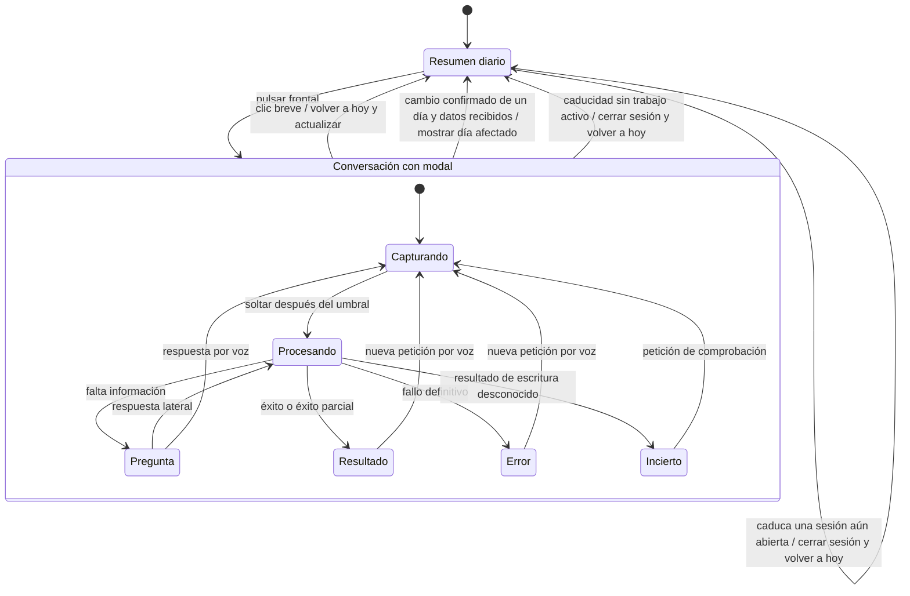

# Sistema de diseño del NOTE4

Estas reglas recogen las decisiones del usuario y deben guiar las pantallas, los componentes y las propuestas visuales del NOTE4. Son el diseño objetivo; no afirman que el firmware instalado ya las implemente. Las propuestas se validan con imágenes antes de llevarlas al dispositivo.

## Información y jerarquía

- Priorizar comida, cena y eventos frente a marca, saludos, ayudas y etiquetas de estructura.
- Prescindir del logo y del texto «NIDO» en las pantallas. La cabecera compacta dedica su espacio a la fecha; en el resumen diario debe ser la fecha del día mostrado, aunque no sea hoy.
- Integrar la referencia relativa y la fecha en una sola línea, por ejemplo «hoy · viernes 02 oct» o «mañana · sábado 03 oct». No colocar «hoy» o «mañana» como etiqueta aislada a la derecha; reservar ese extremo para iconos compactos.
- Reducir la altura de la cabecera y el tamaño de los iconos para adaptarlos a esa franja.
- Mostrar las etiquetas auxiliares en minúscula y con tipografía menor que los datos: «comida», «cena», «agenda». Aplicar la misma jerarquía a otros textos de estructura.
- Mantener nombres de platos, títulos de eventos y horarios como información principal. No convertir esos datos a minúscula automáticamente; conservar su escritura original.
- No llenar el espacio liberado con instrucciones de uso. La estructura debe poder reconocerse sin releer sus etiquetas.

## Tarjetas, volumen y sombreado

- Las tarjetas deben conservar volumen visible: superficie blanca, contorno fino, esquinas suavizadas y sombra desplazada hacia la derecha y abajo. Un rectángulo de contorno sin sombra no satisface esta regla.
- Dibujar los tonos mediante tramas de tinta compatibles con refresco monocromo de 1 bit; evitar degradados que dependan de grises reales.
- La sombra debe distinguirse del fondo y no invadir texto, otras tarjetas ni los límites de pantalla.
- Usar una sombra y unos márgenes consistentes en tarjetas de comida y eventos; evitar una caja decorativa global que reduzca el espacio útil.
- Mantener el texto nítido y sin tramas por debajo. Recortar con «…» sin dividir caracteres UTF-8 cuando no quepa.

## Resumen diario y agenda

En la vista de hoy, comida y cena conservan su tamaño y posición. Dos horas después de la hora configurada de cada comida, atenuar únicamente el contorno y la sombra con la misma trama que los eventos futuros; dibujar después etiqueta y plato en negro nítido. No ocultar tarjetas ni redistribuir el espacio. No atenuar comidas sin planificar ni al consultar otros días. El plugin calcula `lunchPast` y `dinnerPast` con la zona horaria y los horarios de la instalación en cada sincronización; sin datos nuevos se conserva el último estado recibido. Firmware anterior ignora estos campos y un puente anterior los omite, manteniendo el aspecto normal.

- La pantalla de espera muestra comida, cena y eventos del día seleccionado. Si quedan huecos, completar hasta seis tarjetas con eventos de los días siguientes disponibles en la caché, en orden de fecha y horario. Mantener comida, cena y cabecera del día seleccionado. Las tarjetas futuras atenúan solo contorno y sombra con trama gris. El texto se mantiene negro nítido, sin trama; el contenido usa una fuente menor (celdas 6 × 10 frente a 8 × 16 en el día seleccionado). Solo la primera tarjeta de cada día futuro incluye el nombre del día de la semana como etiqueta pequeña arriba a la izquierda (por ejemplo, «sábado»). A partir de siete días de distancia respecto al día mostrado, añadir DD/MM para distinguir semanas. Las citas con hora muestran el horario pequeño abajo a la derecha, con espacio reservado para evitar solapamientos con el título. Mantener el rótulo «agenda» aunque se mezclen fechas; no inventar tarjetas si no hay más datos.
- Los eventos se presentan en tarjetas contiguas por filas. Cada evento con hora muestra inicio y fin en pequeño, abajo a la derecha, con diez píxeles libres entre la tinta del horario y el borde inferior.
- Agenda cards show the configured calendar name at the bottom left, using 3 × 5 glyphs in 4 × 7 cells, smaller than the time. Display at most the first seven Unicode characters, followed by a compact ellipsis only when truncated. Its three one-pixel dots have one blank pixel between them and occupy a single 6 × 7 cell. Count accented characters once and never split UTF-8. Keep the full configured name in settings and in the cached data. The name belongs to the installation; do not infer it from a person or Google ID. Measure the abbreviated label before deciding whether it fits beside the time; otherwise place it immediately above, reserving space for both. Omit an unconfigured name.
- Los eventos de todo el día no muestran horario ni etiqueta «todo el día»; el título conserva la jerarquía principal.
- Prioritize multi-day events that began before the displayed day, followed by all-day events and timed appointments. Multi-day events appear once per grid, with inclusive start/end dates at the top left, separated by a spaced dash: “01/10 - 03/10”. For the selected day's multi-day titles, measure actual word wrapping within the space reserved between dates and footer: retain the 8 × 16 font when the whole title fits, otherwise use the 6 × 10 font with 12-pixel line spacing. Truncate with “…” only if the smaller text still does not fit. Future cards keep their existing smaller typography. Do not repeat multi-day events when filling from future days; keep them available when navigating to another date they span.
- Para hoy, mostrar los eventos de todo el día y las citas en curso o siguientes. Para otras fechas, mostrar los eventos del día en orden horario.
- Indicar con «+N» cuántos eventos quedan fuera de la vista. Distinguir falta de datos, menú sin planificar y ausencia de eventos; un fallo no equivale a un día vacío.
- Adaptar la distribución de uno a seis eventos: uno en una tarjeta; dos o tres en una fila; cuatro en dos filas de dos; cinco en una fila de tres y otra de dos; seis en dos filas de tres. No dibujar cajas vacías. Si hay más de seis, indicar «+N». La legibilidad tiene prioridad sobre la cantidad.

## Iconos y actualización

- Actualizar cada cinco minutos y reiniciar el plazo tras una actualización correcta.
- Aprovechar las interacciones para actualizar: un clic frontal vuelve a hoy y solicita datos recientes; tras un turno de voz, refrescar el resumen para reflejar cambios.
- Durante la actualización conservar el contenido y mostrar solo un icono pequeño de actualización. No hace falta animarlo ni refrescar la pantalla continuamente.
- Si falla una actualización de datos en segundo plano, conservar los últimos datos disponibles y mostrar solo un icono pequeño de error, sin mensajes explicativos ni detalles técnicos. Reintentar en el siguiente intervalo. Los fallos de un turno solicitado al agente se explican en una modal, según el flujo de conversación.
- El lugar y funcionamiento del log se decidirán más adelante. No introducir una pantalla de diagnóstico en esta propuesta.
- La estrategia de sincronización y almacenamiento para navegar por días sin conexión se decidirá por separado.

## Botones y voz

- Botón lateral superior: día anterior. Inferior: día siguiente. Una pregunta binaria mantiene los botones como respuestas mientras esté pendiente.
- Frontal: empezar a capturar audio inmediatamente al pulsar, sin esperar a distinguir clic y pulsación mantenida.
- Si se suelta antes del umbral, descartar el audio sin enviarlo e interpretar la acción como clic: volver a hoy y actualizar.
- Permitir una pulsación mantenida para grabar también durante procesamiento. El envío y el polling se ejecutan en una tarea separada; las actualizaciones de pantalla y los sonidos del agente se aplican después de la captura, sin usar el codec simultáneamente. Si hay un turno activo, al soltar una grabación válida solicitar su parada conservando la sesión y enviar la nueva voz como aclaración de la petición original cuando la parada haya terminado. Conservar los resultados ya confirmados y comprobar posibles escrituras interrumpidas antes de repetirlas. Si no se confirma la parada, no enviar automáticamente la aclaración y explicar que no se ha enviado. Un clic breve solicita detener el turno activo y descarta los mensajes que aún no se han enviado.
- A partir del umbral de clic, mantener la captura. Al soltar, descartar sin enviar las grabaciones válidas de menos de un segundo de audio PCM, excluyendo la preparación del codec. Interpretarlas como una pulsación accidental: restaurar el día o la modal anterior, sin cancelar ni interrumpir un turno activo, renovar la conversación o reproducir un error. A partir de un segundo, enviar siguiendo el flujo de voz. El clic breve conserva su función de navegación o cancelación.
- Umbral inicial propuesto: 200 ms, ajustable tras prueba física; medir desde la pulsación e incluir el arranque del dispositivo.
- Mostrar la pantalla de escucha después del umbral para evitar un cambio de pantalla durante un clic breve, sin retrasar la captura.
- Resolver en la implementación que el botón superior (GPIO39) no despierta desde reposo profundo; no dar por verificada la navegación física a partir de una maqueta.

## Símbolos de los botones físicos

### Revisión acordada para respuestas binarias

Diseño acordado: una única caja blanca contiene las dos respuestas apiladas, sin sombra ni sombreado interior. Un separador horizontal ligero tramado al 50 % distingue ambas respuestas sin tocar los bordes. Cada fila incorpora un botón estrecho en el borde derecho, también blanco y sin sombra, con contorno fino y redondeado solo en sus esquinas exteriores derechas. La posición de las filas representa los botones superior e inferior; no repetir la pareja de iconos dentro de cada respuesta.

Medidas sobre el canvas de 400 × 300: caja común de 320 píxeles de ancho y altura según el contenido (60 píxeles con dos respuestas cortas), radio exterior de 2 píxeles, filas de al menos 30 píxeles y separador con 10 píxeles de margen a cada lado. Cada botón mide 6 × 20 píxeles y comparte su borde izquierdo recto con el borde derecho de la caja, con radio derecho de 2 píxeles. El conjunto de ambos botones se centra respecto al separador, con 4 píxeles de separación entre botones (2 a cada lado de la línea). Su posición se ancla al separador, no al centro de cada fila, también si aumenta la altura de las respuestas. El texto conserva 10 píxeles de margen horizontal dentro de la caja. Cada fila crece de forma independiente según sus líneas de texto; una respuesta larga no obliga a aumentar la otra. El renderer admite hasta dos líneas por respuesta, conserva el borde inferior del bloque y ajusta el espacio del cuerpo de la pregunta para evitar solapamientos. Si el texto supera el espacio disponible, se recorta con «…»; no se reduce la tipografía. Se mantiene la sombra de la modal exterior: esta revisión elimina las sombras de respuestas y botones.

Esta variante se incorpora al firmware 0.4.7 para las respuestas binarias de la modal y de la vista completa; las pruebas nativas cubren respuestas cortas, primera larga, segunda larga, ambas largas y título largo. La comprobación física sigue pendiente. Sustituye para las respuestas binarias el tratamiento de iconos descrito a continuación. El círculo frontal conserva su diseño independiente.

Regla acordada para la próxima versión: identificar las acciones por la forma y posición de sus botones. Los símbolos acompañan al texto de la acción en preguntas, elecciones, cierre de modales, configuración, vinculación, OTA y cualquier otra interacción que indique una pulsación. Mostrar solo acciones disponibles en ese estado; no añadir ayudas permanentes al resumen diario ni alterar los gestos existentes.

- **Lateral superior:** dos rectángulos verticales iguales, estrechos y altos, con esquinas mínimamente redondeadas, uno encima del otro. Ambos llevan contorno fino; resaltar el de arriba solo con una trama ligera interior, dejando el inferior blanco.
- **Lateral inferior:** la misma pareja, resaltando únicamente el rectángulo inferior. Mantener siempre ambos para que su posición sea inequívoca.
- **Frontal:** un círculo con contorno fino y trama ligera interior, siguiendo el mismo tratamiento del lateral indicado.
- El énfasis señala **qué botón pulsar para esa acción**, no una opción seleccionada ni un estado de pulsación ya detectado. En una pregunta binaria cada respuesta tiene su propio símbolo, superior e inferior respectivamente.
- Usar tinta negra y blanco, con trama regular de 1 bit. Mantener el mismo contorno fino en todos los botones, sin sombra exterior ni borde en negrita; no usar grises reales, color, emoji ni caracteres Unicode como sustitutos del dibujo.
- Colocar el símbolo a la izquierda de la etiqueta, centrado verticalmente, con separación suficiente para que no se confunda con una letra. Reservar su anchura antes de ajustar o recortar el texto. Sustituir los prefijos «1 / 2» en las respuestas binarias por estos símbolos, conservando las etiquetas y su orden.
- Una pulsación breve se representa con el símbolo y la acción («Cerrar», «Actualizar», «Configurar»). Una pulsación mantenida añade «mantener» y, si procede, la duración. Una combinación simultánea une los símbolos con «+» y una sola indicación de duración: frontal + lateral inferior, «mantener 5 s». Si exige liberación, mostrar después «suelta ambos» según el flujo existente.
- No ofrecer «Cerrar» con el círculo si el frontal realiza otra acción en ese estado. La acción escrita debe corresponder siempre al comportamiento real; los símbolos no cambian permisos, confirmaciones ni el funcionamiento de los botones.

Parámetros visuales aprobados por el usuario (2026-10-12) a 400 × 300: pareja lateral de 6 × 22 píxeles (rectángulos verticales de 6 × 10, separación vertical de 2 y radio de esquina de 1), círculo de 20 × 20, contorno de 1 píxel en ambas variantes, trama interior negra del 25 % (un punto cada 2 × 2 píxeles) y separación al texto de al menos 8 píxeles. Mantener la misma escala entre las dos variantes laterales y márgenes libres alrededor; centrar la pareja completa respecto a la etiqueta. La pareja cabe centrada en las respuestas actuales de 28 píxeles de alto con 3 píxeles libres arriba y abajo. Estas medidas son ajustables tras revisar su legibilidad en la pantalla física.

Referencia de forma y ubicación: [galería oficial del NOTE4 Devkit](https://zectrix.com/en/note4-developer-kit.html). La corrección acordada conserva cada rectángulo en vertical además de apilar ambos; las medidas del icono son una simplificación gráfica, no medidas del hardware.

[Muestra vectorial con símbolos y pregunta ficticia](assets/note4-design/button-symbols.svg). La muestra recoge el diseño visual aprobado: rectángulos verticales estrechos, esquinas mínimamente redondeadas y énfasis mediante trama ligera interior y contorno fino. La revisión del contorno fino se incorpora en 0.4.7. La 0.4.5 incorpora los laterales a las respuestas binarias, incluidas preguntas de Nido y la elección de OTA. `DrawButtonSymbol` centraliza las tres variantes; las muestras nativas cubren ambos laterales, frontal, combinación, etiquetas largas y modales de pregunta y OTA. El círculo y las combinaciones quedan disponibles para próximas acciones explícitas; no se han añadido acciones nuevas. Verificar que no se recortan ni solapan texto o sombras. Comprobar por separado la legibilidad física.

## Modales y contexto de conversación

- Mantener la misma estructura de cabecera en las vistas del agente: fecha del día visible a la izquierda e iconos compactos a la derecha.
- Mostrar escucha, progreso, preguntas y resultados del agente en una modal blanca con contorno y sombra, sobre el día que se estaba consultando. Centrar la modal horizontal y verticalmente en la pantalla completa. Atenuar todo el fondo, incluida la cabecera, con una trama monocroma; no implementar un desenfoque que dependa de grises.
- Conservar el día y sus datos detrás de la modal durante el turno. Una actualización automática no debe reemplazar ni cerrar una pregunta o interrumpir la captura de audio.
- Si se confirma una modificación que afecta exclusivamente a un día, actualizar los datos y mostrar ese día al cerrar la modal. El resultado debe aportar las fechas afectadas; no deducirlas del texto libre del agente.
- Si afecta a varios días o es una consulta, mostrar el resultado en la modal y conservar el día de origen.
- Un fallo al obtener los datos posteriores a un guardado no convierte ese guardado en fallido: explicar qué se confirmó y conservar los datos anteriores con el icono de error hasta poder refrescarlos.

## Preguntas, fallos y resultados inciertos

- Una pregunta significa que falta información que el usuario puede aportar. Mantener la conversación abierta y esperar voz o una de las dos respuestas laterales cuando sea binaria. No transformar un fallo técnico en una pregunta rutinaria de reintento.
- Un error definitivo del turno solicitado al agente cierra ese turno y muestra una modal con una explicación breve y comprensible. No cerrar la modal inmediatamente; conservar el fondo y permitir una nueva petición por voz. El error del turno no obliga a terminar toda la conversación en ese instante.
- Si hay un éxito parcial, indicar qué se guardó y qué no pudo completarse. No presentar un éxito total ni repetir automáticamente lo ya guardado.
- Si se pierde la respuesta después de que una escritura pudiera ejecutarse, mostrar una modal de resultado incierto: «No he podido confirmar el resultado. Puede haberse guardado». No afirmar que no se aplicó ni volver a ejecutar la escritura automáticamente. Una petición posterior puede comprobar lo ocurrido.
- El usuario puede cerrar una modal en espera o terminada con un clic frontal para volver a hoy y actualizar. Si había una pregunta, se abandona y sus respuestas dejan de estar activas. Las respuestas tardías de esa pregunta no deben reabrirla.
- Un clic frontal durante procesamiento solicita detener el turno y sus especialistas mediante la parada nativa de OpenClaw. Tras el acuse vuelve a hoy. No revierte una escritura ya iniciada. Los turnos activos tienen un plazo de ejecución independiente y sus resultados deben conservarse aunque la vista cambie.

## Caducidad y vuelta automática a hoy

La conversación caduca un minuto después de un resultado (consulta, modificación, error o resultado incierto) y tres minutos después de una pregunta pendiente. El puente determina el plazo y el firmware usa `sessionExpiresAt`.

- Reiniciar el plazo cuando el usuario envía un turno o responde y cuando se presenta una nueva pregunta o un resultado, incluido un error. El usuario debe disponer del plazo completo para leer o responder.
- La actualización automática, el polling y los mensajes repetidos de progreso no renuevan la conversación. El temporizador de sincronización y el de conversación son independientes con plazos distintos.
- No caducar por inactividad mientras se está capturando audio o ejecutando un turno. El trabajo activo usa su propio timeout; si vence con resultado desconocido, pasar a la modal de incertidumbre.
- Al caducar en espera: cerrar la modal, abandonar la pregunta pendiente, invalidar sus botones, finalizar la sesión y volver al resumen de hoy sin modal. La siguiente petición inicia una conversación nueva.
- Volver a hoy utilizando los datos disponibles, sin exigir una conexión correcta para cerrar la conversación. Conservar el icono de error si sigue vigente.
- El cambio automático al día afectado después de una modificación confirmada no impide volver a hoy cuando caduque la conversación.

### Esquema de los estados conversacionales

Este diagrama se centra en conversación y caducidad. La sincronización periódica y la política de energía tienen flujos separados. «Procesando» incluye envío, transcripción y agente; el audio empieza al pulsar, antes del umbral del clic.

El clic breve durante procesamiento solicita detener el turno; no permite perder los resultados ya guardados ni revertir escrituras ejecutadas. El regreso tras un cambio confirmado conserva la sesión hasta su caducidad; cerrar la modal y cerrar la sesión son acciones diferentes.

## Validación visual

- Generar imágenes con la resolución de 400 × 300 y las limitaciones reales del canvas. Si se amplían, usar escala entera sin suavizar píxeles.
- Verificar cabecera sin marca, fecha correcta, etiquetas menores y en minúscula, iconos compactos, sombras visibles, márgenes y textos largos.
- Incluir muestras con pocos eventos, dos filas, eventos de todo el día, varios días, actualización, error y día sin eventos.
- Usar datos ficticios claramente identificados en las propuestas; no presentarlos como consultas a los calendarios familiares.
- Distinguir siempre reglas acordadas, parámetros visuales propuestos y comportamiento realmente implementado o cargado en el NOTE4.

Los tamaños exactos de fuente, cabecera, separación y sombra de las imágenes son parámetros de propuesta hasta validación; la jerarquía, las minúsculas auxiliares, la ausencia de logo y el volumen son reglas acordadas.

## Propuestas visuales guardadas

Muestras ficticias de la segunda propuesta, con cabecera de 34 píxeles, datos en celdas de 8 × 16, auxiliares en 6 × 10 e iconos de aproximadamente 12 × 12. La fuente auxiliar es una fuente bitmap de 5 × 7 dentro de celdas de 6 × 10, incorporada también al renderer del firmware. La sombra se desplaza 3 píxeles a la derecha y 4 hacia abajo. Estas medidas concretas están pendientes de validación.

- [Cuatro eventos con eventos de todo el día](assets/note4-design/four-events-v2.png).
- [Cinco eventos con eventos de todo el día](assets/note4-design/five-events-v2.png).
- [Seis eventos con eventos de todo el día](assets/note4-design/six-events-v2.png).
- [Actualizando, con icono compacto](assets/note4-design/updating-v2.png).
- [Error, con icono compacto](assets/note4-design/error-v2.png).

Las imágenes están ampliadas al doble sin suavizado. No se ha cambiado ni cargado el firmware para estas propuestas.

## Implementación del resumen y las modales

La versión `nido-daily-0.2` implementa el resumen, las modales y la cabecera común en C++, con una máquina explícita `UiFlow` y sin añadir un runtime JavaScript. Descarga quince días (siete antes y siete después del centro) y los conserva en RAM durante el reposo ligero. Esta caché permite navegar sin conexión dentro del bloque; los reinicios requieren descargarlo de nuevo. La estrategia definitiva de persistencia y consumo sigue abierta.

Los errores de actualización mantienen la caché; errores e incertidumbre de un turno solicitado se muestran en modales. El cierre automático usa `sessionExpiresAt` del servidor. Un clic que abandona una pregunta invalida también su sesión; un clic sobre un resultado mantiene la sesión hasta caducidad. `affectedDates` se añade al protocolo únicamente para modificaciones confirmadas y no se infiere del tipo de vista ni del título.

Las imágenes anteriores son propuestas; `note4-firmware test` genera ahora vistas de cero a seis eventos y modales utilizando el renderer de producción. La compilación y las pruebas no sustituyen la comprobación física de botones, audio ni corriente de batería.

## Sonidos

Primera versión aprobada: timbre electrónico original común, inicio de grabación de 120 ms, pregunta de 350 ms, resultado definitivo de 250 ms y error de 350 ms. Reproducir una sola vez al alcanzar el estado, sin avisos en refrescos periódicos. El inicio se reproduce durante la preparación existente del codec, sin esperar al umbral de clic. Comprobar físicamente el volumen y que el sonido no contamine la transcripción; esta comprobación está pendiente. Las muestras están en `assets/note4-sounds/` y el PCM incorporado en `nido_sounds.h`.

## Mantenimiento del dispositivo

Frontal + lateral inferior mantenidos simultáneamente cinco segundos reservan la entrada en mantenimiento; activar al soltar ambos, descartando audio. La misma combinación permite salir. La modal reutiliza el renderer existente y muestra red abierta y dirección web explícita, sobre el resumen atenuado. La prueba nativa genera `daily-modal-maintenance.pgm` con datos ficticios a 400 × 300. Configuración y OTA están implementadas en software; validación física pendiente.

Propuesta QR: modal de 352 × 218 centrada; QR Wi-Fi a la izquierda con módulos de tres píxeles y cuatro módulos de margen blanco, red sin contraseña y dirección alternativa a la derecha. El renderer nativo genera la propuesta con credenciales ficticias; pendiente de aprobación visual y prueba de escaneo en pantalla física.

Vinculación por código: después de guardar la Wi-Fi, usar la modal de texto existente con «Vincular con Nido», seis dígitos, acceso a los ajustes, IP alternativa y caducidad de cinco minutos. `daily-modal-pairing.pgm` reproduce esta pantalla a 400 × 300 con datos ficticios; la prueba física sigue siendo independiente del renderizado.

Actualización desde GitHub: al entrar en mantenimiento, mostrar progreso breve de consulta. Si hay versión posterior, reutilizar la modal binaria con «Nueva versión disponible», versión y «Actualizar / Configurar». Superior acepta; inferior, frontal o treinta segundos continúan a configuración. `daily-modal-github-update.pgm` reproduce la pantalla a 400 × 300; la prueba física es independiente del renderizado.

La pantalla de mantenimiento muestra la versión completa de la aplicación en ejecución, muy pequeña y alineada a la derecha al pie de la modal, debajo de la ayuda para salir. Usar `TextTiny` (glifos de 3 × 5 en celdas de 4 × 7), tinta negra sin sombreado y márgenes libres; conservar el QR y su zona blanca. El dato viene del descriptor del firmware activo, nunca de la release disponible ni del destino de una descarga. Incorporado desde la 0.4.4, cargada y verificada por USB. Incluido también en la 0.4.5; lectura física pendiente de confirmar.

## Firmware update availability

Firmware 0.4.8 adds a compact downward arrow and tray at the right of the daily header, separate from data refresh, error, and low-battery icons. It appears only when the bridge reports `updateAvailable`. The device reports its installed version on home refreshes. The bridge checks the public firmware repository in the background at most once per hour per process, including after failures, and reuses the last successful result. An initial check becomes visible on a subsequent data refresh. A failed GitHub request must not block calendar refreshes or create a calendar error. The icon is advisory: maintenance still checks, asks for confirmation, and verifies the signed firmware before installing.

## Menu ordering

Within each local day of the menu calendar, the first event by start instant is lunch and the second is dinner. A single event is lunch, including an all-day event. Changing configured meal times does not change this classification. Cancelled events are ignored. More than two events, equal start instants, or a pair containing an all-day event require clarification; the previous successful snapshot is retained on a conflict. Compare actual instants across daylight-saving changes, rather than clock labels. Configured times still control creation defaults and the meal dimming threshold.

## Quiet firmware update and startup

Retain the daily view during queued OTA downloads and accepted GitHub installations, changing only the compact header status slot. A configured connected startup must not paint an empty summary or a startup modal: the panel retains its previous physical image, including an existing update icon, until fresh home data arrives. Failed retries leave it untouched. Explicit voice and maintenance interactions can replace it; initial setup still displays its instructions. The first fresh frame uses a full refresh. Verify physical behavior separately from the native previews `daily-firmware-updating.pgm` and `daily-firmware-error.pgm`.
